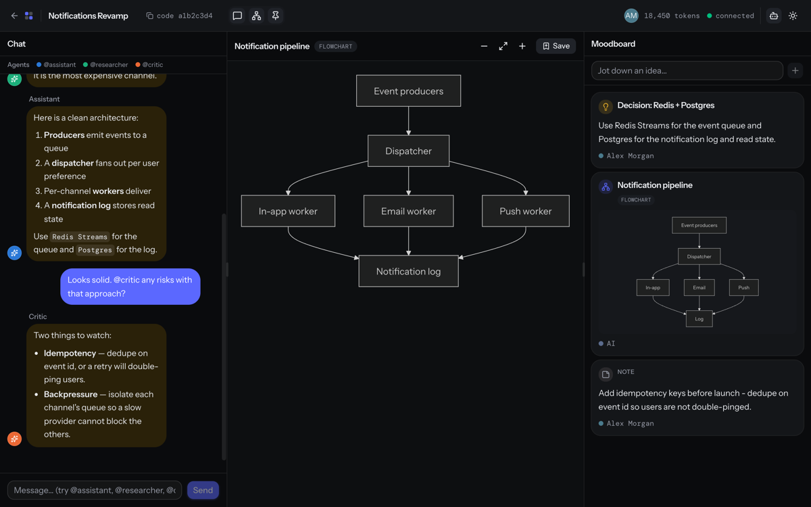
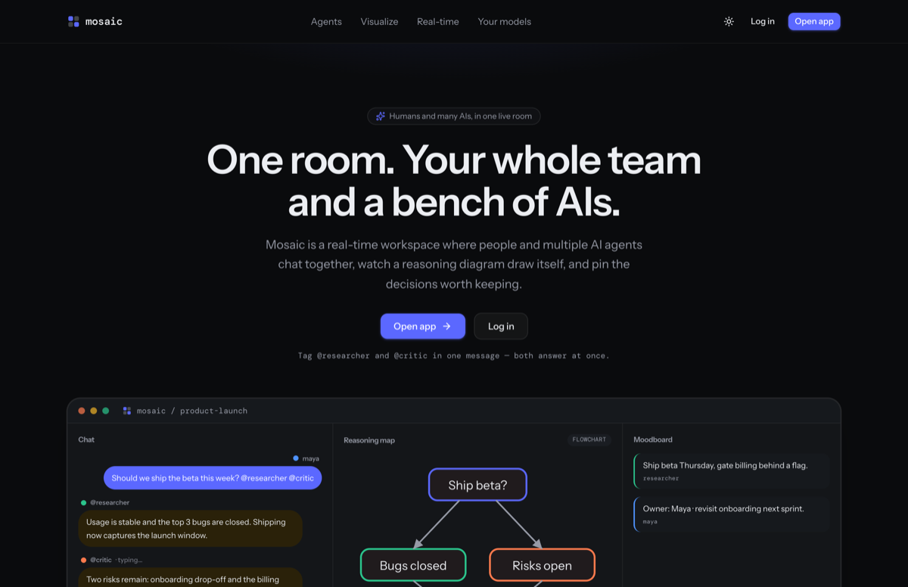
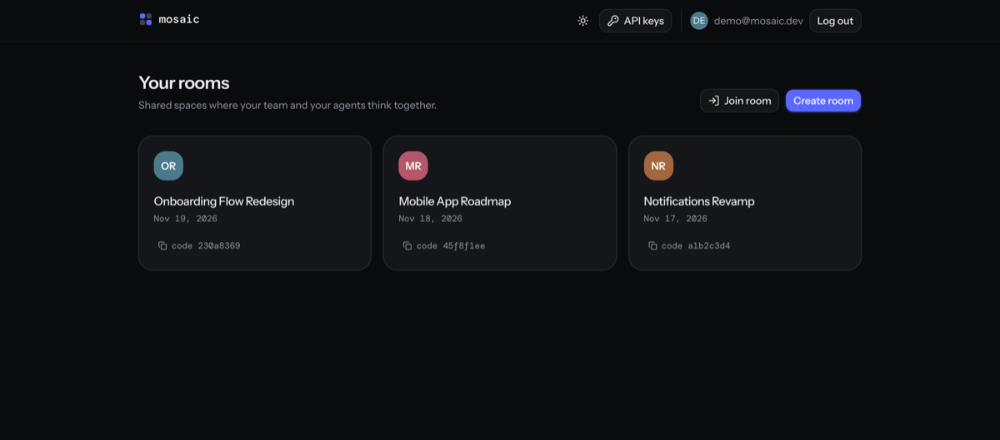

# Mosaic

**A real-time workspace where a team of people and a bench of AI agents think together in one room** — shared chat, a diagram that the AI redraws from the conversation, and a moodboard of the decisions worth keeping.

Mention several agents in one message and they answer concurrently, each streaming token-by-token. The centre pane doesn't draw a fixed diagram — the AI picks whichever Mermaid form (flowchart, mindmap, timeline…) best fits what's being discussed and renders it live. Anything worth keeping — a distilled decision, a saved diagram, a note — gets dragged onto a bento-style moodboard.

<p align="center">
  
</p>

---

## Highlights

- **Multi-agent rooms.** `@mention` one or more agents in a single message; each replies on its own goroutine, streaming concurrently with per-agent attribution (name + colour). `@`-autocomplete in the composer.
- **Provider-agnostic model layer + BYOK.** One `Provider` interface behind OpenAI, Anthropic, and Google. Users bring their own API keys, stored **AES-256-GCM encrypted** (only a `last4` is ever returned to the client).
- **Generative visualization.** Instead of a predefined graph, the model is prompted to diagram the *substance* of the current topic and choose the fitting Mermaid diagram type. Invalid output is caught and auto-repaired via a round-trip, with a client-side fallback so the pane never hangs.
- **Moodboard as a real board.** Distilled **idea** cards (one cheap AI call), saved **diagram** snapshots, and free-text **notes** — drag a message or the live diagram straight onto the board, reorder cards, and open any card for detail (idea → insight + original message; diagram → full-screen). Responsive bento grid via CSS container queries.
- **Real-time collaboration.** A hand-rolled Go WebSocket hub (one goroutine owns each room's state; everything else flows through channels) powers live chat, presence, and typing indicators.
- **Access control.** Supabase Row-Level Security with membership-scoped policies and `SECURITY DEFINER` RPCs; rooms are shared by a join code and can be renamed (members) or deleted (owner).

<p align="center">
  
  
</p>

---

## Tech stack

| Layer | Choices |
|---|---|
| **Frontend** | Next.js 16 (App Router, Turbopack), React 19, TypeScript, Tailwind v4, shadcn/ui on [Base UI](https://base-ui.com), `@xyflow`→**Mermaid** for viz, `react-markdown`, `react-resizable-panels`, `next-themes`, `sonner` |
| **Backend** | Go 1.25 — `chi` router, `gorilla/websocket`, a custom per-room hub, `openai-go`, `golang-jwt/v5`, `golang.org/x/time/rate` |
| **Data / Auth** | Supabase (Postgres + Auth) — RLS, JWT (HS256 + ES256/JWKS), local Docker stack |
| **AI** | OpenAI / Anthropic / Google behind one provider interface; `gpt-4o-mini` by default |

## How it works

```
┌────────────┐   WebSocket    ┌──────────────────────────┐   REST (service role)   ┌────────────┐
│  Next.js   │ ◀────────────▶ │  Go hub                  │ ◀─────────────────────▶ │  Supabase  │
│  (3 panes) │   chat / viz   │  • 1 goroutine per room  │   messages, rooms,      │  Postgres  │
│            │   presence     │  • per-agent concurrency │   agents, encrypted     │  + Auth    │
│            │   typing       │  • provider abstraction  │   BYO keys              │  (RLS)     │
└────────────┘                └──────────────────────────┘                         └────────────┘
```

Each room is owned by a single goroutine that holds its client set; the AI streaming, viz generation, and idea distillation run on their own goroutines and communicate back through channels, so no shared state is locked. The backend talks to Postgres with the service-role key (bypassing RLS); the browser talks to Supabase directly under membership-scoped RLS.

## Repository layout

```
frontend/   Next.js app (App Router, components, lib)
backend/    Go WebSocket + HTTP server (hub, providers, crypto, viz)
supabase/   Local Supabase config + SQL migrations
docs/       Screenshots
```

## Running locally

**Prerequisites:** Node 20+, Go 1.25+, Docker Desktop, the [Supabase CLI](https://supabase.com/docs/guides/cli), and an OpenAI API key.

```bash
# 1. Start the local Supabase stack (prints URLs + keys) and apply migrations
supabase start
supabase migration up

# 2. Configure env (fill in the keys printed by `supabase start`)
cp frontend/.env.local.example frontend/.env.local   # anon key, NEXT_PUBLIC_WS_URL=ws://localhost:8080
cp backend/.env.example        backend/.env          # service_role key, JWT secret, OPENAI_API_KEY, ENCRYPTION_KEY

# 3. Run the backend and the frontend (separate terminals)
cd backend  && go run .        # http://localhost:8080  (GET /health)
cd frontend && npm install && npm run dev   # http://localhost:3000
```

- `ENCRYPTION_KEY` must be a **32-byte base64** string (used to encrypt BYO provider keys) and must stay stable across restarts.
- Local Supabase uses `supabase migration up`, **not** `db push` (that's for a linked remote project).

## Notable engineering decisions

- **Concurrency without locks.** The hub gives each room a single owning goroutine; slow work (model calls) is offloaded and results are funnelled back over a buffered channel, avoiding shared-state races by design. A per-agent busy map lets different agents reply at once while preventing double-triggering one agent.
- **Secrets never leave the server in the clear.** BYO keys are encrypted at rest (AES-256-GCM, master key from env); the API only ever exposes provider + label + `last4`. An ownership trigger prevents an agent from pointing at another user's key (IDOR).
- **Resilient AI output.** Model-authored Mermaid is validated client-side, repaired once via the backend, and falls back to an error state on a timeout — the diagram pane can't get stuck.
- **RLS done safely.** Membership checks use a `SECURITY DEFINER` helper to avoid recursive policy evaluation; room create/join/rename/delete go through audited RPCs.

> Built as a portfolio project to demonstrate real-time systems, a provider-agnostic AI layer, and production-minded security and UX.
